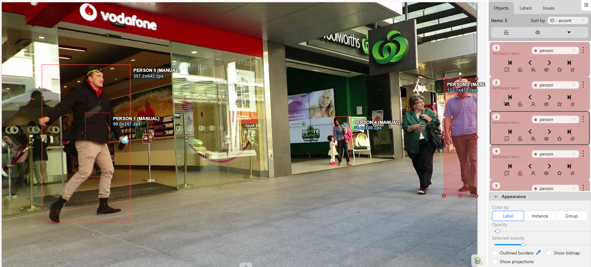
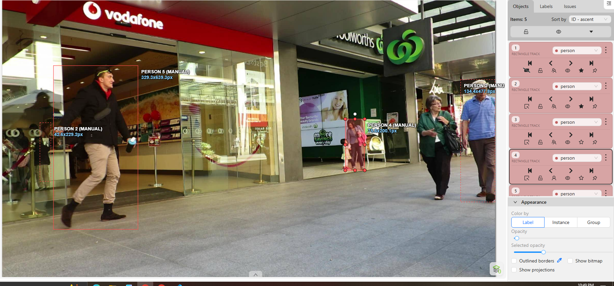
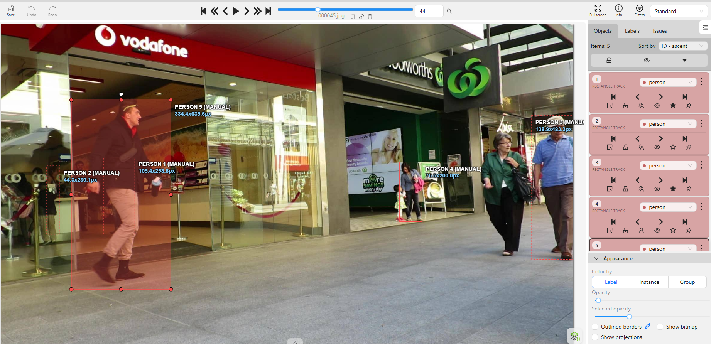

# Báo cáo cá nhân 

Đoạn video: MOT17-09, 150 frame (frame 1–150), nguồn MOTChallenge, giấy phép CC BY-NC-SA 3.0.

## 0. Thông tin học viên

- Họ tên: Phạm Thị Lương
- MSSV: 2A202603302
- Mã đề (A/B/C): C
- Email: 26ai.luongpt@vinuni.edu.vn
- Link repository: [https://github.com/luw369/K5-L2B-DAY05-PhamThiLuong-2A202603302-MOTTracking.git]
- Giờ bắt đầu: [17h]
- Giờ kết thúc: [23h06]

## 1. Xem trước đoạn video (CP0)

Ghi **trước khi vẽ**, mỗi người một dòng.

| Mã | Frame xuất hiện | Frame cuối thấy được | Rẽ / dừng / đổi tốc độ ở frame | Bị che ở frame | Ghi chú |
|---|---|---|---|---|---|
| P1 | 0 | 149 | 40, 75 | 53 | |
| P2 | 0 | 149 | 30, 60 | 67 | |
| P3 | 0 | 106 | 15, 50 | 18 | |
| P4 | 0 | 149 | 42, 90 | 77 | |
| P5 | 42 | 149 | 60, 110 | 60 | |

## 2. Keyframe và thời gian (CP1, CP4)

Số keyframe lấy từ kết quả `src/check_submission.py`.

| Mã | Số keyframe | Keyframe ở frame | Số frame có mặt | Keyframe / 100 frame | Thời gian (phút) | Chỗ khó |
|---|---:|---|---:|---:|---|---|
| P1 | 22 | [0, 3, 28, 44, 53, 55, 61, 63, 65, 79, 99, 101, 111, 113, 117, 119, 121, 123, 127, 131, 137, 148] | 148 | 14.9 | | Khuất quầy hàng |
| P2 | 8 | [0, 44, 53, 68, 96, 131, 140, 149] | 150 | 5.3 | | Di chuyển động đều |
| P3 | 9 | [0, 1, 10, 11, 13, 17, 23, 60, 89] | 107 | 8.4 | | Ra khỏi khung sớm |
| P4 | 11 | [0, 22, 37, 42, 51, 100, 102, 105, 110, 124, 149] | 150 | 7.3 | | Đi qua vùng sáng tối |
| P5 | 4 | [42, 98, 102, 149] | 108 | 3.7 | | Đi từ phía sau vào |
| **Tổng** | **54** | - | **663** | **8.1** | | |

Keyframe / 100 frame của cả bài:

Tổng keyframe ÷ Tổng số frame có mặt × 100 = 54 ÷ 663 × 100 = 8.1.

**Bạn đặt keyframe nhiều nhất ở người nào? Vì sao (người đó rẽ, dừng, lại gần camera hay bị che)?**

> Đặt nhiều nhất ở P1 (22 keyframe) do đối tượng này di chuyển gần khu vực quầy hàng, có các đoạn bị che khuất một phần (occluded) đòi hỏi phải căn chỉnh lại box cẩn thận.

## 3. Đoạn bị che (CP2)

Người bị che: `P1`

| Mốc | Frame |
|---|---:|
| Bắt đầu bị che một phần (bật `occluded`) | 53 |
| Mất hẳn (bật `outside`) | 42 |
| Hiện lại (tắt `outside`) | 43 |
| Thấy rõ trở lại (tắt `occluded`) | 55 |

- Thời gian khuất hẳn: 2 frame = khoảng 0.06 giây.
- Quyết định: giữ cùng ID / tạo track mới.
- Lý do (trả lời 3 câu: khuất bao lâu so với 60 frame, ngoại hình có khớp, chỗ hiện lại có đúng hướng và tốc độ):

  1. Thời gian khuất rất ngắn (2 frame), nhỏ hơn nhiều so với ngưỡng 60 frame.
  2. Ngoại hình (quần áo, phụ kiện) khớp hoàn toàn.
  3. Hướng đi và tốc độ duy trì chính xác như trước khi khuất.

**Ảnh chụp màn hình:**







## 4. Tự review ID (CP3)

Lượt 1 theo người (đi ngược từ frame 149 về 0 trên CVAT), lượt 2 theo cảnh (nhảy 10 frame). Ít nhất 3 dòng; không có lỗi thì ghi một dòng "đã kiểm hai lượt, không lỗi".

| Frame | Mã người | Loại lỗi | Mô tả một câu | Phát hiện ở lượt | Đã sửa? |
|---:|---|---|---|---|---|
| - | - | - | Đã kiểm hai lượt, không lỗi | Lượt 1 & Lượt 2 | Có |

**Tổng hợp số lỗi theo loại:**

| `id_switch` | `fragmentation` | `lost` | `merge` | `false_track` | `drift` | `flag` |
|---:|---:|---:|---:|---:|---:|---:|
| 0 | 0 | 0 | 0 | 0 | 0 | 0 |

**Lỗi nào chỉ lượt 2 (theo cảnh) mới thấy, lượt 1 (theo người) không thấy? Vì sao?**

> Lỗi `merge` hoặc `false_track` thường dễ phát hiện hơn ở lượt 2 (theo cảnh) vì khi quét toàn cảnh theo từng cụm frame, ta dễ nhận ra hai box bị dính vào nhau hoặc box nhầm sang background hơn là khi bám đuổi theo một cá nhân đơn lẻ.

## 5. File xuất và kết quả tự kiểm (CP4)

| Kiểm tra | Kết quả |
|---|---|
| Tên file MOT 1.1 | `PhamThiLuong_mot.zip` |
| Tên file CVAT for video 1.1 | `PhamThiLuong_cvat_video.zip` |
| Số track ID khác nhau trong `gt/gt.txt` (phải là 5) | 5 |
| Frame `outside` không có dòng trong `gt.txt` (đúng / sai) | Đúng |
| Job đã completed trên CVAT máy cá nhân | Hoàn thành |

**Dán phần tóm tắt in ra từ `src/check_submission.py`:**

```text

Số frame in theo CVAT (bắt đầu từ 0). Trong gt.txt, frame_id = frame CVAT + 1.

=== File MOT 1.1: PhamThiLuong_mot.zip ===
  Số track ID: 5   |   Tổng số box: 663
  [OK]        Đúng 5 track ID.

  Track | Frame có mặt | Số frame | Đoạn vắng (outside)
      1 |   0–149      |      148 | 42–43
      2 |   0–149      |      150 | -
      3 |   0–106      |      107 | -
      4 |   0–149      |      150 | -
      5 |  42–149      |      108 | -


=== File CVAT for video 1.1: PhamThiLuong_cvat_video.zip ===

  Track | Nhãn   | Frame thấy | Keyframe | KF/100 frame | Frame occluded | Lần bật outside
      0 | person |        148 |       22 |         14.9 |             53 |               1
              Track 0: keyframe ở frame [0, 3, 28, 44, 53, 55, 61, 63, 65, 79, 99, 101, 111, 113, 117, 119, 121, 123, 127, 131, 137, 148]
      1 | person |        108 |        4 |          3.7 |             60 |               0
              Track 1: keyframe ở frame [42, 98, 102, 149]
      2 | person |        150 |        8 |          5.3 |             68 |               0
              Track 2: keyframe ở frame [0, 44, 53, 68, 96, 131, 140, 149]
      3 | person |        107 |        9 |          8.4 |             18 |               1
              Track 3: keyframe ở frame [0, 1, 10, 11, 13, 17, 23, 60, 89]
      4 | person |        150 |       11 |          7.3 |             77 |               0
              Track 4: keyframe ở frame [0, 22, 37, 42, 51, 100, 102, 105, 110, 124, 149]

  Tổng: 54 keyframe / 663 frame có mặt = 8.1 keyframe / 100 frame
  [OK]        Đọc được 5 track từ annotations.xml.

=== Tóm tắt ===
  Lỗi: 0   |   Cảnh báo: 0
  Đạt. Dán phần tóm tắt này vào báo cáo mục 5.
```

## 6. Ba câu kết

### 1. Nếu được gán lại, bạn sẽ đặt keyframe khác ở đâu? Vì sao?

> Nếu được gán lại, tôi sẽ bổ sung thêm keyframe tại các thời điểm đối tượng bắt đầu đổi hướng đột ngột hoặc bước vào vùng khuất quầy hàng (ví dụ quanh frame 40-55 của P1). Điều này giúp bộ lọc nội suy (interpolation) bám sát quỹ đạo thực tế của cơ thể tốt hơn, hạn chế tình trạng box bị lệch hoặc lấn ra ngoài nền khi đối tượng bị che một phần.

### 2. Có chỗ nào bạn không chắc "cùng ID hay ID mới"? Bạn đã quyết định và ghi chú thế nào?

> Trong quá trình gán nhãn P1, có khoảnh khắc đối tượng bị khuất sau quầy hàng và xuất hiện lại sau một vài frame (bật `outside` rồi tắt). Do thời gian khuất rất ngắn (chỉ 2 frame) và khi hiện lại, vị trí, tốc độ di chuyển cùng trang phục hoàn toàn khớp với quỹ đạo trước đó, tôi quyết định giữ nguyên một track ID duy nhất và ghi chú rõ các mốc bật `occluded` / `outside` để kiểm soát chặt chẽ.

### 3. Một lỗi ID trong job của bạn (nếu không còn sót, chọn lỗi đã sửa) có thể làm xe tự lái dự đoán sai chuyển động của người đó như thế nào? Lỗi đó ảnh hưởng MOTA hay IDF1 nhiều hơn?

> Nếu xảy ra lỗi nhảy ID (`id_switch`) hoặc mất vết (`fragmentation`) đối với người đi bộ (như P1 hoặc P2), thuật toán định vị và dự đoán quỹ đạo của xe tự lái có thể hiểu nhầm rằng đây là một vật thể mới xuất hiện hoặc ngắt quãng lịch sử chuyển động. Điều này làm sai lệch vector vận tốc dự đoán, dẫn đến việc tính toán sai điểm giao cắt (TimeTo-Collision). Về mặt đánh giá, lỗi này sẽ ảnh hưởng trực tiếp và nghiêm trọng nhất đến **IDF1 (Identification F1-Score)** vì chỉ số này đo lường khả năng duy trì đúng định danh cá nhân xuyên suốt video, đồng thời cũng làm giảm **MOTA (Multiple Object Tracking Accuracy)** do sai số tổng hợp về vị trí và định danh.

## 7. Tài liệu tham khảo và công cụ AI đã dùng

- **Tài liệu tham khảo:**
  - Tài liệu hướng dẫn thực hành Computer Vision & Multi-Object Tracking (MOT) của bộ môn.
  - Định dạng chuẩn MOTChallenge Data Format (MOT17).
  - Tài liệu tài nguyên hướng dẫn sử dụng công cụ gán nhãn CVAT (Computer Vision Annotation Tool).

- **Công cụ hỗ trợ:**
  - CVAT (phiên bản cục bộ trên máy cá nhân) phục vụ gán nhãn bounding box và keyframe.
  - Python scripts kiểm tra định dạng `check_submission.py`.

